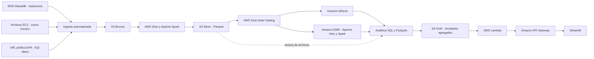

# Arquitectura conceptual

El diagrama sigue la dirección en que se publican los datos y resultados. Las solicitudes de visualización viajan desde Streamlit hacia API Gateway y se ejecutan en Lambda. El módulo 1 caracteriza las fuentes desde el equipo local. Los componentes del diagrama corresponden a etapas futuras y carecen de despliegue en este módulo.

| Componente o capa | Responsabilidad prevista |
| --- | --- |
| RDS MariaDB | Alojar la tabla de origen de estaciones cargada a partir de `aqs_sites.zip`. La ingesta conservará una exportación de la tabla junto con una referencia verificable al ZIP original. |
| Archivos EC2 | Proveer las mediciones horarias de EPA AirData como archivos del sistema, con nombre y versión de origen verificables. |
| URL pública EPA | Proveer el ZIP del AQI diario por condado en cada ejecución de ingesta según una política de actualización registrada. |
| Ingesta automatizada | Obtener la exportación de MariaDB, los archivos de EC2 y el ZIP de la EPA. Registrar origen, fecha, bytes, huella y estado para que las repeticiones sean trazables e idempotentes. |
| S3 Bronze | Conservar los datos recibidos sin transformaciones analíticas, sus representaciones originales cuando estén disponibles y metadatos de procedencia. Preservar versiones para reproducir y auditar el ETL. |
| AWS Glue y Apache Spark | Leer Bronze de forma distribuida. Tipificar, normalizar unidades, validar claves, resolver duplicados conforme al diccionario y registrar rechazos y métricas de calidad. |
| S3 Silver | Almacenar `stations`, `ozone_measurements` y `daily_air_quality` validadas en Parquet, con el grano descrito en el [diccionario](diccionario-datos.md). Decidir las particiones tras medir tamaños y patrones de consulta. Año y mes son candidatos para tablas temporales. |
| Glue Data Catalog | Registrar esquemas, ubicaciones y particiones de las tablas externas en S3. Publicar el mismo contrato de lectura para varios motores y mantener las definiciones alineadas con el ETL. |
| Athena, EMR, Hive y Spark | Athena consulta S3 mediante SQL usando el catálogo. En EMR, Hive y Spark usan Glue Data Catalog como metastore compartido y leen los mismos archivos de S3. SparkSQL ejecuta consultas sobre las tablas y PySpark prepara agregaciones y diagnósticos descriptivos. |
| S3 Gold | Almacenar resultados agregados de las seis preguntas en Parquet junto con cobertura, metodología y referencias a las versiones Silver. Para la API se podrán añadir exportaciones compactas indexadas por filtro a partir de esas mismas métricas. |
| Lambda, API Gateway y Streamlit | API Gateway recibe los filtros de Streamlit y los envía a Lambda. Lambda consulta artefactos agregados de Gold y devuelve JSON con valores, unidades y cobertura. Streamlit consume la API y presenta las comparaciones mediante gráficos y tablas. |

## Capas Medallion y formato de almacenamiento

La arquitectura Bronze, Silver y Gold permite reprocesar desde los datos recibidos, auditar cada transformación y compartir resultados listos para consulta. Si cambian los datos de la EPA o una regla de calidad, las versiones y los metadatos permiten rastrear qué entradas produjeron una métrica y reconstruirla.

Parquet almacena los campos por columna con tipos explícitos y compresión. Las consultas de ozono y AQI suelen leer solo una parte de las variables, como los códigos, la fecha y la medida. Los motores pueden leer esas columnas y, según el filtro y el diseño de particiones, omitir archivos o grupos de filas. Glue y Spark escriben los datos procesados en S3. Athena, Hive y Spark los consultan a través del catálogo, mientras S3 conserva los archivos. [Apache Parquet](https://parquet.apache.org/docs/overview/), [Athena y catálogo](https://docs.aws.amazon.com/athena/latest/ug/work-with-data-stores.html), [catálogo para Spark en EMR](https://docs.aws.amazon.com/emr/latest/ReleaseGuide/emr-spark-glue.html), [catálogo para Hive en EMR](https://docs.aws.amazon.com/emr/latest/ReleaseGuide/emr-hive-metastore-glue.html).
