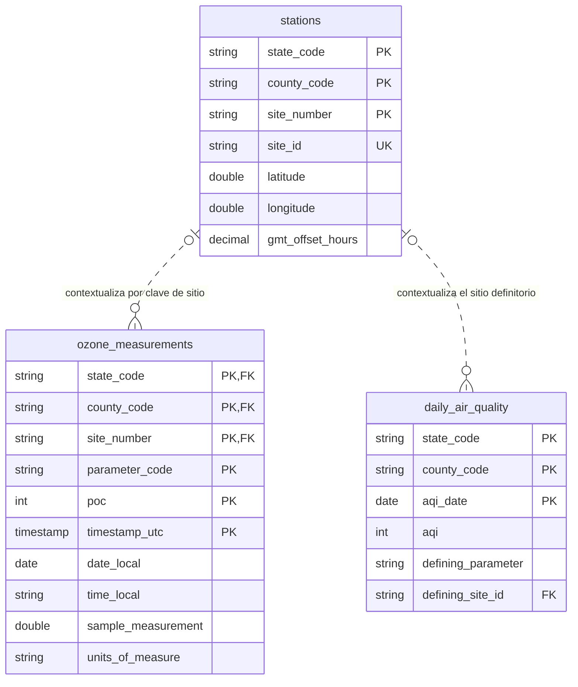

# Diccionario y modelo lógico preliminar

El mapeo conserva el orden y las mayúsculas de los encabezados de los tres CSV oficiales observados en el [reporte de validación](evidencias/validation_report.json). Los tipos indican el contrato lógico de Silver. El CSV de origen se conserva sin transformar y los tipos físicos se definirán en el módulo de ETL.

## `stations`

**Granularidad.** Un sitio de monitoreo AQS por fila en la versión de `aqs_sites.csv`. Puede contener sitios de distintos parámetros y períodos.

**Clave primaria propuesta.** (`state_code`, `county_code`, `site_number`). `site_id` es una representación derivada y única de la misma clave en formato `SS-CCC-NNNN`. La existencia de un sitio describe el catálogo de estaciones disponible, mientras la actividad de 2024 se determina con las mediciones.

| Encabezado EPA | Campo lógico | Tipo | Descripción |
| --- | --- | --- | --- |
| `State Code` | `state_code` | STRING | Componente estatal de la clave del sitio. |
| `County Code` | `county_code` | STRING | Componente de condado de la clave. |
| `Site Number` | `site_number` | STRING | Número de sitio dentro del condado. |
| `Latitude` | `latitude` | DOUBLE | Latitud en grados decimales. |
| `Longitude` | `longitude` | DOUBLE | Longitud en grados decimales. |
| `Datum` | `datum` | STRING | Referencia geodésica de las coordenadas. |
| `Elevation` | `elevation_m` | DOUBLE | Altitud del sitio en metros sobre el nivel del mar. |
| `Land Use` | `land_use` | STRING | Uso predominante del suelo en el entorno del sitio. |
| `Location Setting` | `location_setting` | STRING | Clasificación del entorno del sitio. |
| `Site Established Date` | `site_established_date` | DATE | Fecha reportada de inicio del sitio. |
| `Site Closed Date` | `site_closed_date` | DATE | Fecha reportada de cierre, si existe. |
| `Met Site State Code` | `met_state_code` | STRING | Código estatal del sitio meteorológico de referencia. |
| `Met Site County Code` | `met_county_code` | STRING | Código de condado del sitio meteorológico de referencia. |
| `Met Site Site Number` | `met_site_number` | STRING | Código de sitio meteorológico de referencia. |
| `Met Site Type` | `met_site_type` | STRING | Tipo de sitio meteorológico de referencia. |
| `Met Site Distance` | `met_distance_m` | DOUBLE | Distancia al sitio meteorológico, en metros. |
| `Met Site Direction` | `met_direction_degrees` | DOUBLE | Dirección reportada al sitio meteorológico, en grados. |
| `GMT Offset` | `gmt_offset_hours` | DECIMAL(6,3) | Diferencia en horas entre la hora estándar local del sitio y GMT. |
| `Owning Agency` | `owning_agency` | STRING | Entidad propietaria o responsable del terreno. |
| `Local Site Name` | `local_site_name` | STRING | Nombre local del sitio. |
| `Address` | `address` | STRING | Dirección reportada del sitio. |
| `Zip Code` | `postal_code` | STRING | Código postal, con ceros iniciales cuando corresponda. |
| `State Name` | `state_name` | STRING | Nombre para presentación. |
| `County Name` | `county_name` | STRING | Nombre para presentación. |
| `City Name` | `city_name` | STRING | Nombre de la ciudad reportada. |
| `CBSA Name` | `cbsa_name` | STRING | Área estadística basada en núcleos, si se informa. |
| `Tribe Name` | `tribe_name` | STRING | Identificación tribal, si se informa. |
| `Extraction Date` | `extraction_date` | DATE | Fecha de extracción de AQS, con alcance de versión del catálogo. |

## `ozone_measurements`

**Granularidad.** Una observación horaria del parámetro de ozono por monitor y hora de inicio, candidata al grano limpio de `hourly_44201_2024.csv`.

**Clave primaria candidata.** (`state_code`, `county_code`, `site_number`, `parameter_code`, `poc`, `timestamp_utc`). La combinación de sitio, parámetro y POC identifica el monitor AQS. POC distingue ocurrencias o instrumentos del mismo parámetro dentro del sitio. Un POC aislado carece de alcance global. La unicidad de la clave candidata se verificará sobre todas las filas en el ETL.

| Encabezado EPA | Campo lógico | Tipo | Descripción |
| --- | --- | --- | --- |
| `State Code` | `state_code` | STRING | Estado del sitio. |
| `County Code` | `county_code` | STRING | Condado del sitio. |
| `Site Num` | `site_number` | STRING | Código de sitio dentro del condado. |
| `Parameter Code` | `parameter_code` | STRING | Código AQS `44201`, correspondiente a ozono. |
| `POC` | `poc` | INTEGER | Código de ocurrencia del parámetro dentro del sitio. |
| `Latitude` | `latitude` | DOUBLE | Latitud reportada con la observación. |
| `Longitude` | `longitude` | DOUBLE | Longitud reportada con la observación. |
| `Datum` | `datum` | STRING | Referencia geodésica reportada con la observación. |
| `Parameter Name` | `parameter_name` | STRING | Nombre del parámetro. |
| `Date Local` | `date_local` | DATE | Fecha del inicio de la muestra en hora estándar local. |
| `Time Local` | `time_local` | STRING | Hora de inicio estándar local en formato `HH:mm`. |
| `Date GMT` | `date_gmt` | DATE | Fecha GMT del inicio. |
| `Time GMT` | `time_gmt` | STRING | Hora GMT del inicio en formato `HH:mm`. |
| `Sample Measurement` | `sample_measurement` | DOUBLE | Concentración horaria reportada. En Silver se expresa en ppm. |
| `Units of Measure` | `units_of_measure` | STRING | Unidad reportada. La muestra observa `Parts per million`. |
| `MDL` | `method_detection_limit` | DOUBLE | Límite de detección del método. |
| `Uncertainty` | `measurement_uncertainty` | DOUBLE | Incertidumbre reportada, si existe. |
| `Qualifier` | `qualifier` | STRING | Calificador de calidad, evento o motivo de ausencia. |
| `Method Type` | `method_type` | STRING | Clasificación del método de muestreo. |
| `Method Code` | `method_code` | STRING | Código del método de muestreo. |
| `Method Name` | `method_name` | STRING | Descripción del método. |
| `State Name` | `state_name` | STRING | Nombre del estado para presentación. |
| `County Name` | `county_name` | STRING | Nombre del condado para presentación. |
| `Date of Last Change` | `last_change_date` | DATE | Fecha de última modificación reportada por AQS. |
| Derivado de `Date GMT` y `Time GMT` | `timestamp_utc` | TIMESTAMP | Instante de inicio normalizado a UTC. |

## `daily_air_quality`

**Granularidad.** Un índice diario general publicado por condado y fecha en `daily_aqi_by_county_2024.csv`.

**Clave primaria candidata.** (`state_code`, `county_code`, `aqi_date`). `defining_site_id` puede referenciar `stations.site_id` como dato de contexto. En una muestra directa se observó el formato `01-003-0010`. El parámetro que define el AQI puede variar por día y condado. [EPA sobre AQI por condado](https://aqs.epa.gov/aqsweb/documents/aqi/aqi_data.html), [diccionario AQS](https://aqs.epa.gov/aqsweb/documents/AQS_Data_Dictionary.html).

| Encabezado EPA | Campo lógico | Tipo | Descripción |
| --- | --- | --- | --- |
| `State Name` | `state_name` | STRING | Nombre del estado para presentación. |
| `county Name` | `county_name` | STRING | Nombre del condado. Se conserva la grafía original en Bronze. |
| `State Code` | `state_code` | STRING | Código estatal como texto. |
| `County Code` | `county_code` | STRING | Código de condado como texto. |
| `Date` | `aqi_date` | DATE | Fecha diaria publicada para el condado. |
| `AQI` | `aqi` | INTEGER | Valor adimensional del índice, válido si es entero no negativo. |
| `Category` | `aqi_category` | STRING | Categoría reportada para ese valor de AQI. |
| `Defining Parameter` | `defining_parameter` | STRING | Contaminante que determinó el índice diario. |
| `Defining Site` | `defining_site_id` | STRING | Identificador compuesto del sitio que definió el AQI. |
| `Number of Sites Reporting` | `number_of_sites_reporting` | INTEGER | Conteo de sitios reportantes publicado en la fila. |

## Relaciones

Las referencias a estaciones son lógicas. Para enriquecer ozono, usar la clave compuesta y una dimensión de sitios previamente validada como única. Para enriquecer AQI, validar el formato y consistencia geográfica del sitio definitorio y usar `stations.site_id`. Conservar las observaciones con clave propia válida y sin metadato coincidente, registrando los faltantes. La relación analítica entre ozono y AQI se construye después de obtener una serie derivada única por condado y fecha, como se especifica abajo.

## Calidad y preparación para análisis

1. **Claves y ámbito.** Leer todos los códigos de origen como texto. Para las claves estadounidenses, validar las longitudes de dos, tres y cuatro caracteres para estado, condado y sitio. Conservar los ceros iniciales y evitar conversiones intermedias a enteros. Mantener separados los nombres de presentación y los identificadores. Retener el archivo completo en Bronze y limitar el análisis a los 50 estados y al Distrito de Columbia durante 2024. Validar los componentes de cada clave y documentar los códigos especiales. [EPA sobre códigos de estado](https://aqs.epa.gov/aqsweb/helpfiles/state_code.htm), [formatos AirData](https://aqs.epa.gov/aqsweb/airdata/FileFormats.html).
2. **Unidades y validez.** La muestra de `44201` usa `Parts per million` (ppm), de acuerdo con la unidad de ozono indicada por la EPA. Validar todos los valores distintos de `Units of Measure` en el ETL. Separar unidades inesperadas hasta tener una conversión documentada. Usar mediciones numéricas finitas que cumplan la política de calidad, conservar `qualifier`, MDL e incertidumbre y definir la exclusión conforme al significado de los calificadores AQS. No imputar valores ausentes ni aplicar sustituciones adicionales por MDL a valores ya publicados. [Formatos AirData](https://aqs.epa.gov/aqsweb/airdata/FileFormats.html), [documentación de ozono en ppm de la EPA](https://www.epa.gov/system/files/documents/2022-04/environmental-contaminants-methods_criteria-pollutants.2021.pdf).
3. **Tiempo.** `date_local` y `time_local` expresan hora estándar local del sitio, sin ajuste de horario de verano. `date_gmt` y `time_gmt` se combinan en `timestamp_utc` con UTC explícito mediante sesiones configuradas en UTC. Conservar ambas parejas para auditar el desfase, incluso si la fecha GMT cae en un día o año distinto. Cuando sea posible, contrastar el desfase con `gmt_offset_hours`. Filtrar 2024 y derivar día de semana, mes y hora a partir de los campos locales. Para el AQI usar la fecha del CSV como día publicado. Alinear con `date_local` del ozono por fecha de calendario sin desplazar el AQI a UTC. [Formatos AirData](https://aqs.epa.gov/aqsweb/airdata/FileFormats.html), [diccionario AQS](https://aqs.epa.gov/aqsweb/documents/AQS_Data_Dictionary.html).
4. **Duplicados.** Eliminar copias idénticas en una misma versión. Al consolidar revisiones de una medición con la misma clave, conservar la de `last_change_date` inequívocamente más reciente. Aislar conflictos de mediciones con fecha empatada o indeterminada y conflictos en estaciones o AQI sin un criterio de versión verificable. Registrar descartes y validar unicidad antes de cualquier unión.
5. **De monitor a condado.** Por sitio, fecha local y hora, si un monitor tiene varias observaciones válidas distintas en la misma franja, promediar primero dentro de ese monitor y franja. Promediar después los POC válidos con igual peso para obtener un valor por sitio-hora. Calcular una media diaria por sitio con igual peso por franja y al menos 18 de las 24 horas válidas. Promediar con igual peso los sitios-día elegibles de un condado. Un condado-día de ozono es válido cuando al menos un sitio cumple el mínimo. Conservar el número de sitios y horas válidas para diagnosticar cambios de cobertura. Los días faltantes quedan fuera del promedio. Los resultados describen la red observada.
6. **Cruce con AQI y cobertura.** Construir una fila de ozono diario por (`state_code`, `county_code`, `date_local`) y una fila de AQI válido por (`state_code`, `county_code`, `aqi_date`). Comprobar unicidad en ambos lados, emparejar por los dos códigos y la fecha y contar ausencias de cada lado. El sitio definitorio sirve como contexto. El porcentaje de excedencia de AQI usa como denominador únicamente las fechas con AQI válido. Los [umbrales de cobertura](preguntas-negocio.md) se aplican después de validar cada serie. La cobertura, los pares y el contaminante definitorio acompañarán las estimaciones.

La inspección del módulo 1 confirma los encabezados y una muestra inicial. La presencia global de nulos, la unicidad, la integridad referencial, la consistencia temporal y la cobertura efectiva se comprobarán cuando se implemente el ETL.
