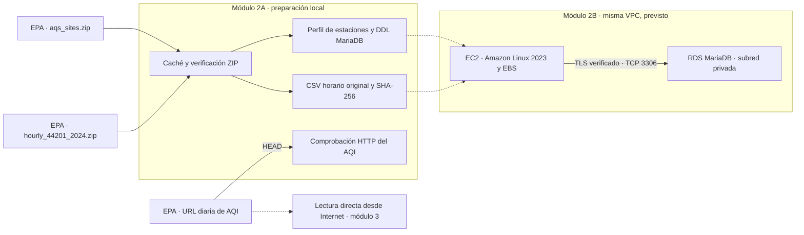

# Arquitectura de las fuentes

- **Estaciones.** Actividad local de perfil, validación completa y DDL. En 2B, EC2 ejecutará el cargador desde el ZIP oficial y escribirá el catálogo completo en `air_quality_source.stations` por TLS.
- **Ozono horario.** El archivo destinado a EC2 es `hourly_44201_2024.csv`. La preparación extrae los bytes del ZIP, registra el tamaño y calcula SHA-256. El volumen EBS mantendrá el archivo durante las pausas de la instancia.
- **AQI diario.** La URL de EPA AirData es la fuente operativa. El módulo 2A comprueba su disponibilidad y conserva metadatos HTTP. La descarga de referencia del módulo 1 sigue en la caché local. El consumidor del módulo 3 consultará la URL pública directamente.

Los enlaces punteados representan actividades futuras. Las opciones de red y permisos se detallan en el [plan de despliegue](plan-despliegue.md), y las decisiones de almacenamiento y ciclo de vida en el [plan de costos](plan-costos.md).
