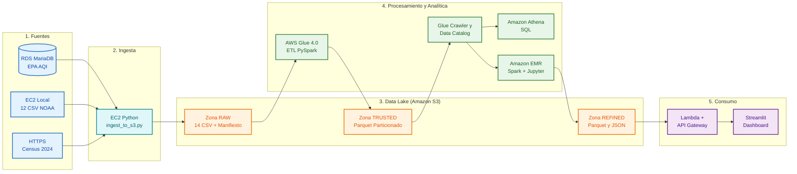

# Plataforma Big Data para el análisis de la calidad del aire, clima y población en Estados Unidos durante 2024

Proyecto académico de Tópicos Especiales en Telemática, Universidad EAFIT. Construye una plataforma reproducible en **AWS** bajo el patrón **Medallion (Raw → Trusted → Refined)** para integrar datos públicos de calidad del aire (**EPA AirData**), meteorología diaria (**NOAA**) y población por condado (**U.S. Census Bureau**) de 2024, analizar sus patrones descriptivos y exponer los resultados mediante una API REST y un dashboard interactivo.

## Arquitectura



## Módulos

| Módulo | Alcance | Estado |
| --- | --- | --- |
| 1. Definición del caso de estudio | Preguntas de negocio (P1–P6), validación de fuentes, modelo de datos y arquitectura conceptual. | Completado ([detalle](01-caso-estudio/README.md)) |
| 2. Configuración de fuentes de datos | Preparación de RDS MariaDB (TLS 1.2+), almacenamiento en EC2 y verificación de origen HTTPS. | Completado ([detalle](02-fuentes-datos/README.md)) |
| 3. Ingesta de datos | Carga de EPA en MariaDB e ingesta inmutable (SHA-256) de EPA, NOAA y Census hacia S3 Raw (14 objetos). | Completado ([detalle](03-ingesta-datos/README.md)) |
| 4. Procesamiento de datos | ETL en PySpark sobre AWS Glue que limpia, integra y publica 4 datasets Parquet particionados en S3 Trusted (`323,540` filas en `aqi_weather`). | Completado ([detalle](04-procesamiento-datos/docs/etl_raw_to_trusted.md)) |
| 5. Catalogación con Glue y EMR/Hive | Registro automático de tablas y particiones (`year`, `month`) en `airquality_trusted` vía Glue Crawler, compartido con Athena y EMR. | Completado |
| 6. Analítica con Athena y SparkSQL | Consultas SQL descriptivas (P1–P6) sobre S3 Trusted aplicando *partition pruning* (`WHERE year = '2024'`). | Completado (`05-analitica/sql/athena_queries.sql`) |
| 7. Analítica descriptiva con PySpark | Procesamiento distribuido en Amazon EMR (JupyterHub), correlaciones Pearson/Spearman y publicación de 11 tablas en S3 Refined. | Completado (`05-analitica/notebooks/`) |
| 8. API Gateway y Visualización | Exposición *serverless* de S3 Refined vía AWS Lambda + API Gateway (HTTP API) y dashboard interactivo en Streamlit. | Completado (`06-visualizacion/`) |

## Estructura del repositorio

```text
├── 01-caso-estudio/          # Preguntas de negocio, diccionario de datos y validación inicial
├── 02-fuentes-datos/         # Perfilado y preparación de orígenes (MariaDB, EC2, URL)
├── 03-ingesta-datos/         # Carga a RDS e ingesta inmutable hacia S3 Raw (ingest_to_s3.py)
├── 04-procesamiento-datos/   # ETL PySpark Raw -> Trusted (etl_raw_to_trusted.py)
├── 05-analitica/             # Consultas SQL de Athena y notebook PySpark/SparkSQL de EMR
└── 06-visualizacion/         # Función AWS Lambda (lambda_function.py) y app Streamlit (app.py)
```

## Resumen de datos y hallazgos principales (2024)

* **Volumen e integración:** `329,597` registros EPA (RDS) + `1,137,162` registros NOAA válidos (EC2, tras descartar `18,642` filas centinela `-999.99`) + `3,144` condados Census (URL, tras filtrar `SUMLEV = 050`) → **`323,540` observaciones integradas** (`98.16%` cobertura EPA–NOAA, `99.20%` cobertura Census, `975` condados en `48` estados/DC).
* **Calidad general y episodios críticos (P1 y P5):** El `74.1%` de los días son categoría *Good* (mediana AQI `40`), pero el **ozono explica el `68.45%`** de los `3,911` días insalubres (`AQI > 100`). Lideran San Bernardino (`103.33` AQI), Riverside (`98.96`, `40.16%` del año > 100) y Los Ángeles (`94.48`, `1,297M` persona-días expuestos).
* **Estacionalidad y clima (P2, P3, P4 y P6):** En el panel balanceado (`709` condados con cobertura completa), el pico ocurre en **julio** (`53.01` AQI, `24.32 °C`). *Nota metodológica:* al trabajar sobre el dataset diario integrado, P4 analiza el perfil climático diario (temperatura máxima × lluvia), confirmando que los días calurosos ($\ge 30\,^\circ\text{C}$) y secos promedian `56.04` AQI (`5.27%` > 100) frente a `33.18` (`0.10%`) en días fríos con lluvia.

## Cómo ejecutar el proyecto

### Prerrequisitos
* Cuenta AWS (o AWS Academy Learner Lab) con AWS CLI configurado, roles `LabRole` / `LabInstanceProfile`, bucket S3, instancia EC2 y RDS MariaDB dentro de la VPC.
* Python 3.10+ en EC2 con entorno virtual activo:
  ```bash
  python3 -m venv .venv && source .venv/bin/activate
  pip install boto3 pymysql streamlit requests pandas plotly
  ```
* Variables de entorno base:
  ```bash
  export AWS_REGION="us-east-1"
  export ACCOUNT_ID="<TU_ACCOUNT_ID>"
  export S3_BUCKET="<TU_BUCKET_S3>"
  export AWS_PAGER=""
  ```

### 1. Ingesta hacia S3 Raw (desde EC2)
Configura las credenciales de MariaDB (`DB_HOST`, `DB_USER`, `DB_PASSWORD`, `DB_NAME`, `DB_SSL_CA`) y ejecuta la carga e ingesta hacia la zona Raw:
```bash
python3 03-ingesta-datos/scripts/load_daily_aqi.py --execute
python3 03-ingesta-datos/scripts/ingest_to_s3.py --bucket "${S3_BUCKET}" --year 2024
```

### 2. ETL Raw → Trusted y Catalogación (AWS Glue)
1. Sube `04-procesamiento-datos/scripts/etl_raw_to_trusted.py` a `s3://${S3_BUCKET}/scripts/` y ejecuta el Glue Job apuntando a `--raw-prefix s3://${S3_BUCKET}/raw` y `--trusted-prefix s3://${S3_BUCKET}/trusted`.
2. Ejecuta el **AWS Glue Crawler** sobre `s3://${S3_BUCKET}/trusted/` para registrar las tablas (`epa`, `noaa`, `census`, `aqi_weather`) en la base de datos `airquality_trusted`.

### 3. Consultas SQL (Amazon Athena)
En la consola de **Amazon Athena**, selecciona la base `airquality_trusted`, configura la ruta de salida en `s3://${S3_BUCKET}/athena-results/` y ejecuta las consultas de `05-analitica/sql/athena_queries.sql`.

### 4. Analítica distribuida y publicación a Refined (Amazon EMR)
1. Crea un clúster EMR (`emr-6.15.0` con `Spark`, `Hive`, `JupyterHub` y `Livy`) configurado con `AWSGlueDataCatalogHiveClientFactory` para leer directamente `airquality_trusted.aqi_weather`.
2. Abre JupyterHub (`https://<MASTER_DNS>:9443`), carga el notebook de `05-analitica/notebooks/` con el kernel **PySpark** y ejecuta todas las celdas para generar los 11 datasets en `s3://${S3_BUCKET}/refined/parquet/` y `s3://${S3_BUCKET}/refined/json/`.
3. Al finalizar, termina el clúster EMR para evitar costos innecesarios:
   ```bash
   aws emr terminate-clusters --region "${AWS_REGION}" --cluster-ids "<CLUSTER_ID>"
   ```

### 5. Despliegue de API (Lambda + API Gateway) y Dashboard (Streamlit)
1. Empaqueta y despliega la función Lambda y la HTTP API:
   ```bash
   zip -j /tmp/lambda_api.zip 06-visualizacion/lambda_function.py

   aws lambda create-function \
     --region "${AWS_REGION}" \
     --function-name airquality-refined-api \
     --runtime python3.12 \
     --role "arn:aws:iam::${ACCOUNT_ID}:role/LabRole" \
     --handler lambda_function.lambda_handler \
     --zip-file fileb:///tmp/lambda_api.zip \
     --timeout 15 \
     --environment "Variables={S3_BUCKET=${S3_BUCKET},REFINED_PREFIX=refined/json}"

   export API_ID=$(aws apigatewayv2 create-api \
     --region "${AWS_REGION}" \
     --name si3007-airquality-http-api \
     --protocol-type HTTP \
     --target "arn:aws:lambda:${AWS_REGION}:${ACCOUNT_ID}:function:airquality-refined-api" \
     --query "ApiId" --output text)

   aws lambda add-permission \
     --region "${AWS_REGION}" \
     --function-name airquality-refined-api \
     --statement-id "apigw-invoke-${API_ID}" \
     --action lambda:InvokeFunction \
     --principal apigateway.amazonaws.com \
     --source-arn "arn:aws:execute-api:${AWS_REGION}:${ACCOUNT_ID}:${API_ID}/*/*"

   export API_URL="https://${API_ID}.execute-api.${AWS_REGION}.amazonaws.com"
   curl -s "${API_URL}/health"
   ```
2. Con el puerto TCP `8501` abierto en el Security Group de tu EC2, lanza Streamlit:
   ```bash
   streamlit run 06-visualizacion/app.py --server.port 8501 --server.address 0.0.0.0
   ```
3. Abre `http://<EC2_PUBLIC_IP>:8501` en tu navegador para explorar las métricas KPI y las pestañas interactivas **P1–P6**.

## Referencias internas

Los README del [módulo 1](01-caso-estudio/README.md), el [módulo 2](02-fuentes-datos/README.md), las [fases de ingesta EPA y NOAA](03-ingesta-datos/README.md) y el [procesamiento del dataset integrado](04-procesamiento-datos/README.md) detallan validaciones y evidencias por etapa. Las [instrucciones del proyecto](AGENTS.md) rigen el trabajo incremental.
